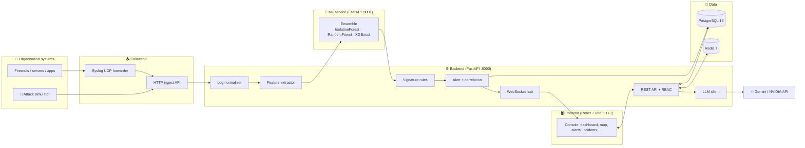
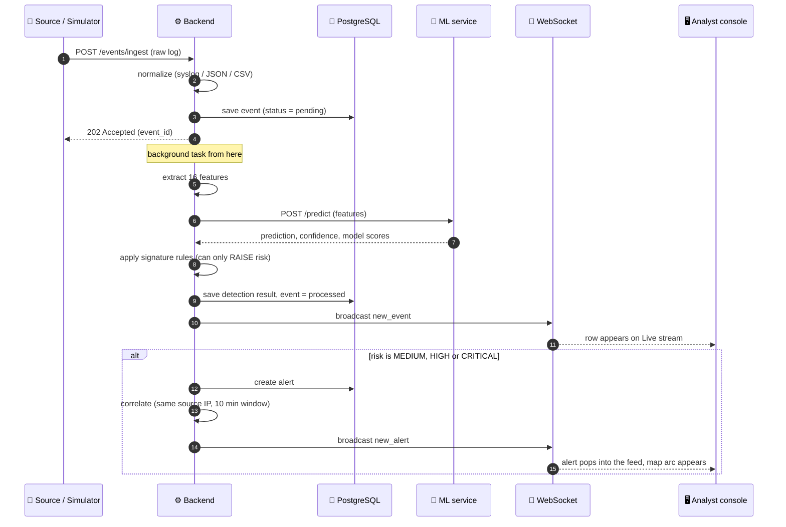
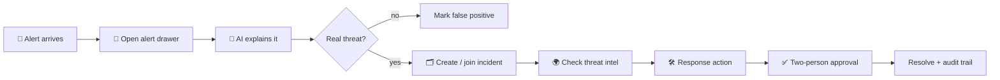
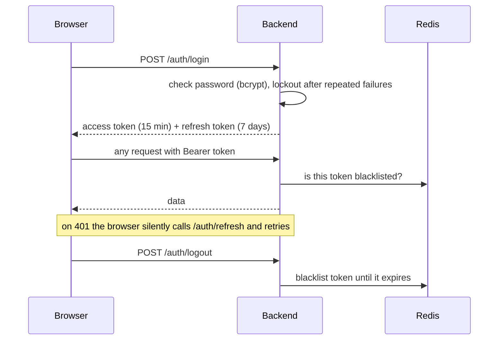
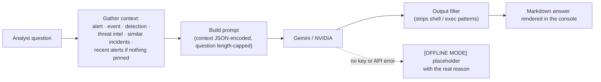
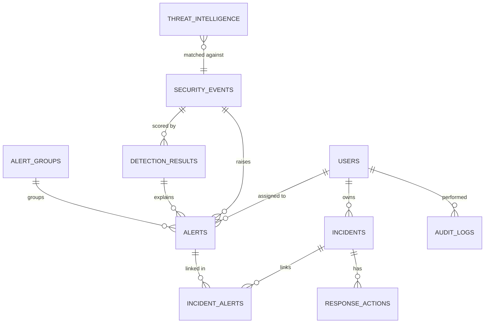
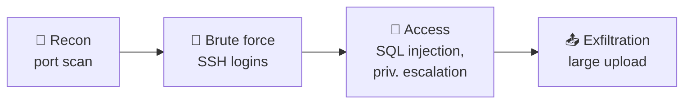

<!--
  PDF NOTE: this file uses emoji, tables, Mermaid diagrams and a little inline HTML for colour.
  To export: open in VS Code with "Markdown Preview Mermaid Support" + "Markdown PDF", or Typora, or
  `pandoc "final project.md" -o final.pdf --pdf-engine=xelatex` (Mermaid needs a pre-render step in pandoc).
  The <div style="page-break-after: always;"> lines are the page breaks.
-->

<div align="center">

# 🛡️ SENTINEL

### <span style="color:#00b24b">AI-powered</span> Security Operations Center platform

**See every attack. Stop it faster.**


**Final end-to-end project review** · architecture · data flow · what we built · how to run and demo it · honest status

</div>

<div style="page-break-after: always;"></div>

## 📑 Contents

| # | Section | # | Section |
|---|---|---|---|
| 1 | 🎯 What this project is | 9 | 🧪 Attack simulation |
| 2 | 🧩 What we built (feature map) | 10 | ⚡ Performance engineering |
| 3 | 🏗️ System architecture | 11 | 🚀 How to run it |
| 4 | 🔄 End-to-end data flow | 12 | 🎬 Demo script |
| 5 | 🤖 Detection engine | 13 | ✅ Testing and verification |
| 6 | 🔌 Backend (API, DB, security) | 14 | ⚠️ Limitations and next steps |
| 7 | 🖥️ Frontend (pages, design) | 15 | 🗂️ Repository map |
| 8 | 📡 Data collection | 16 | 📖 Glossary |

---

## 1. 🎯 What this project is

> <span style="color:#0075ff">**One line:**</span> Sentinel takes raw security logs from an organisation's systems, scores every event with machine learning plus signature rules, turns the dangerous ones into alerts, groups related alerts into attacker stories, and shows everything on a live console where an analyst can investigate, ask an AI assistant, and respond.

### The problem

A Security Operations Center (SOC) analyst drowns in logs. Firewalls, servers and apps emit thousands of lines an hour, almost all harmless. The job is to find the few lines that matter, understand *who* is attacking *what*, and decide what to do, fast.

### Our answer

| Pain in a real SOC | What Sentinel does |
|---|---|
| Too many logs | ML + rules score every event, only risky ones become alerts |
| Same attacker, 50 alerts | Alerts from the same source IP within 10 minutes are grouped |
| "Who is attacking us, from where?" | Live **world attack map** with zoom and click-for-details |
| "How far did the attacker get?" | **Attack paths** page: recon → brute force → access → exfiltration |
| "Is this IP known bad?" | Threat-intel lookup built into incidents |
| "What does this alert mean?" | **AI assistant** explains it and recommends next steps |
| "What happened last week vs now?" | Live / History toggle with 1h, 24h, 7d, 30d ranges |
| Hard to demo | **17-scenario attack simulator** (phishing, DDoS, ransomware, ...) |

### Who it is for

SOC analysts (triage and investigate), admins (users, settings, model health), and the project team (demo and evaluation).

<div style="page-break-after: always;"></div>

## 2. 🧩 What we built (feature map)

| Area | Features | Status |
|---|---|---|
| 🔐 **Auth and access** | Login, refresh tokens, logout (token blacklist), account lockout, change password, 4 roles (admin, analyst, viewer, api_client) | 🟢 Done |
| 📥 **Ingestion** | HTTP ingest (single and batch), log normalizer (syslog, JSON, CSV), syslog UDP forwarder | 🟢 Done |
| 🤖 **Detection** | 3-model ML ensemble + signature rules (hybrid), risk levels LOW to CRITICAL | 🟢 Done |
| 🚨 **Alerts** | Auto-created from risky events, status workflow, assign, comment, correlation groups | 🟢 Done |
| 🗂️ **Incidents** | Create from alerts, timeline, response actions with two-person approval, AI recommendations, TI context panel | 🟢 Done |
| 🌍 **Threat intel** | IOC lookup, list, add (IP, domain, hash, URL) | 🟢 Done |
| 🧠 **AI assistant** | Analyze, explain alert, recommend for incident, offline fallback, output filtering | 🟢 Done (Gemini) |
| 📊 **Analytics** | Dashboard KPIs, trends, top attackers, top targets, geo, attack paths, model metrics, system health | 🟢 Done |
| 📡 **Real time** | WebSocket: new alerts, new events (live stream), health, incident updates | 🟢 Done |
| 🖥️ **Console UI** | 15 pages, dark SOC design system, responsive, paginated lists | 🟢 Done |
| 🧪 **Simulation** | 17 attack scenarios, kill-chain campaign, traffic replayer | 🟢 Done |
| 🧾 **Audit** | Every write is logged (who, what, before/after) | 🟢 Done |
| 🌐 **Real geolocation** | Currently a deterministic stand-in | 🟠 Placeholder |
| 🎯 **Model quality** | Trained on a balanced real-data extract, high false-positive rate on benign traffic | 🟠 Needs work |

<div style="page-break-after: always;"></div>

## 3. 🏗️ System architecture

### 3.1 The big picture



### 3.2 The three services

| Service | Port | Role | Tech |
|---|---|---|---|
| 🖥️ **Frontend** | 5173 | The analyst console | React 18, Vite, Tailwind 3, Zustand, TanStack Query, React Router 6, Recharts, d3-geo |
| ⚙️ **Backend** | 8000 | API, auth, detection pipeline, WebSocket, assistant | FastAPI 0.115, SQLAlchemy 2, Alembic, Pydantic 2, python-jose, passlib, httpx |
| 🤖 **ML service** | 8001 | Scores one event at a time | FastAPI, scikit-learn 1.5, XGBoost 2.1, pandas, joblib |
| 💾 **PostgreSQL 16** | 5432 | Events, alerts, incidents, users, audit log, threat intel | |
| ⚡ **Redis 7** | 6379 | Token blacklist, rate limits, dashboard cache | |

> 💡 **Why a separate ML service?** The model can be retrained, scaled or replaced without touching the API. The backend only needs a URL (`ML_SERVICE_URL`).

### 3.3 Design choices and why

| Choice | Reason |
|---|---|
| Modular monolith backend, not microservices | A small team, one deployable, still clean module boundaries (routers → services → models) |
| ML as its own service | Different dependencies, different release cycle |
| WebSocket for live data | Alerts and events must appear without refreshing |
| Redis for cache and blacklist | Fast, expiring keys (logout, rate limit, 30 s dashboard cache) |
| Hybrid ML + rules | The model alone missed many attack types (see section 5) |
| LLM behind an offline fallback | The app works with no key; with a key, the analyst gets real explanations |

<div style="page-break-after: always;"></div>

## 4. 🔄 End-to-end data flow

### 4.1 From log line to alert (the core pipeline)



**Step by step**

1. **Ingest:** a log arrives through the HTTP API (or the UDP forwarder, which calls it). The request returns immediately.
2. **Normalize:** the raw text becomes structured fields (source/destination IP and port, protocol, event type).
3. **Features:** the event is mapped onto the 16 numbers the models were trained on.
4. **Score:** the ML service returns a label, a confidence and one score per model.
5. **Rules:** signature rules check the event type and statistics. A rule can raise the risk, never lower it.
6. **Persist and push:** the result is stored, and `new_event` goes to every connected analyst.
7. **Alert:** MEDIUM and above become an alert, are correlated with related alerts, and `new_alert` is pushed.

### 4.2 Analyst workflow



### 4.3 Sign-in and session



The session survives a page refresh (stored in the browser). Signed-in users are redirected away from `/login`; signed-out users are redirected to it, and sent back to the page they wanted after signing in.

### 4.4 AI assistant flow



<div style="page-break-after: always;"></div>

## 5. 🤖 Detection engine

Detection has **two layers**, the way real SOC tools work: statistical models for the unknown, signatures for the known.

### 5.1 Layer 1: ML ensemble

| Model | Type | Idea |
|---|---|---|
| 🌲 Isolation Forest | Unsupervised | Flags events that look unlike normal traffic |
| 🌳 Random Forest | Supervised | Votes across many decision trees trained on labelled attacks |
| ⚡ XGBoost | Supervised | Boosted trees, strong on tabular data |

The three scores are combined into one **confidence** and a **risk level**.

**The 16 features** (what a model sees): `duration`, `src_port`, `dst_port`, `protocol_enc`, `packet_size_avg`, `bytes_sent`, `bytes_recv`, `packet_count`, `failed_auth_ratio`, `port_entropy`, `syn_count`, `unique_dst_ports`, `conn_rate`, `ttl_avg`, `is_private_src`, `is_private_dst`.

> A single log line cannot carry flow statistics like `syn_count`. So ports, protocol and public/private flags come from the log, and the rest use benign defaults unless the event supplies them (JSON events can carry any feature by name).

### 5.2 Layer 2: signature rules (`backend/app/services/rules.py`)

| Rule family | Matches | Risk |
|---|---|---|
| 💣 Data exfiltration, ransomware, privilege escalation, DDoS | event type keywords, `syn_count > 5000` | 🔴 CRITICAL |
| 🎣 Phishing, C2 beaconing, SQL injection, web exploit, DNS tunnelling, credential attacks | event type keywords, large outbound transfer | 🟠 HIGH |
| 🔭 Reconnaissance (scan, sweep) | keywords, `unique_dst_ports > 100` | 🟡 MEDIUM |

Rules **only raise** risk. A hit is recorded as `signature_rules` in the event's model scores so analysts can see why.

### 5.3 Why two layers (a real finding)

While building the simulator we tested every attack scenario against the live model. The currently trained ensemble decides **mostly by destination port**: ports 22, 21, 23 and 25 look "malicious", almost everything else looks "normal" regardless of traffic statistics. Floods, exfiltration, phishing and C2 all scored as normal. The rules layer fixes that for demos and for known attack types.

### 5.4 Model metrics (current `metrics.json`)

| Model | F1 | AUC-ROC | Trained on |
|---|---|---|---|
| Isolation Forest | 0.55 | 0.53 | `prepared_balanced.csv` |
| Random Forest | 0.99 | 1.00 | `prepared_balanced.csv` |
| XGBoost | 0.99 | 1.00 | `prepared_balanced.csv` |

> ⚠️ **Read these carefully.** Near-perfect supervised scores on a balanced extract do not mean good real-world detection. In practice about **25% of normal internal traffic is flagged MEDIUM**. The next step is retraining and evaluating on UNSW-NB15 or CICIDS2017 with a proper train/test split and a false-positive target (`scripts/run_ml.sh --train unsw ...`).

### 5.5 Risk and alerting

| Risk level | Becomes an alert? | Colour in UI |
|---|---|---|
| LOW | No | grey |
| MEDIUM | Yes | 🟡 |
| HIGH | Yes | 🟠 |
| CRITICAL | Yes | 🔴 |

Alerts from the same source IP within **10 minutes** share an alert group, so one attacker is one story, not fifty rows.

<div style="page-break-after: always;"></div>

## 6. 🔌 Backend

### 6.1 Layout

```
backend/app/
├── routers/      HTTP endpoints (auth, users, events, alerts, incidents, intelligence, assistant, analytics, websocket)
├── services/     business logic (detection, alerts, analytics, rules, geo, assistant, auth, ...)
├── models/       SQLAlchemy ORM (13 tables)
├── schemas/      Pydantic request/response shapes
├── background/   ml_processor (event → score → alert), alert_correlator
├── middleware/   rate limiter, audit logger
├── llm/          provider client + prompt templates
├── ws/           WebSocket connection manager
└── core/         config, database, Redis, security, dependencies
```

### 6.2 API at a glance

| Group | Endpoints |
|---|---|
| 🔐 **Auth** | `POST /auth/login` · `/auth/logout` · `/auth/refresh` · `GET /auth/me` · `PUT /auth/change-password` |
| 👥 **Users** (admin) | `GET/POST /users` · `GET/PUT /users/{id}` |
| 📥 **Events** | `POST /events/ingest` · `/events/ingest/batch` · `GET /events` · `/events/{id}` · `/events/{id}/detection` · `/events/status/{id}` · `DELETE /events/{id}` |
| 🚨 **Alerts** | `GET /alerts` · `/alerts/{id}` · `PUT .../status` · `.../assign` · `POST .../comment` · `/alerts/correlate` |
| 🗂️ **Incidents** | `GET/POST /incidents` · `GET/PUT /incidents/{id}` · `.../timeline` · `POST .../alerts` · `POST .../response-actions` · `PUT .../response-actions/{id}` |
| 🌍 **Intelligence** | `GET /intelligence/lookup` · `/intelligence/iocs` · `POST /intelligence/iocs` |
| 🧠 **Assistant** | `POST /assistant/analyze` · `/assistant/explain/{alert_id}` · `/assistant/recommend/{incident_id}` |
| 📊 **Analytics** | `GET /analytics/dashboard` · `/trends` · `/top-sources` · `/top-targets` · `/attack-paths` · `/geo` · `/models` |
| ❤️ **System** | `GET /api/v1/system/health` · `GET /health` · `WS /ws?token=...` |

All under `/api/v1`. Interactive docs: **http://localhost:8000/docs**.

**ML service:** `POST /predict` · `POST /batch` · `GET /models` · `GET /health` → http://localhost:8001/docs

### 6.3 Database (PostgreSQL, managed by Alembic)



Main tables: `users`, `security_events`, `detection_results`, `alerts`, `alert_groups`, `incidents`, `incident_alerts`, incident history, `response_actions`, `threat_intelligence`, `audit_logs`, `ml_models`.

### 6.4 Security controls 🔒

| Control | How |
|---|---|
| Authentication | JWT access (15 min) + refresh (7 days) tokens, bcrypt password hashes |
| Logout that works | Token id stored in a Redis blacklist until expiry |
| Brute-force defence | Account lockout after repeated failed logins |
| Authorisation | Role checks on routes (`require_role`): admin, analyst, viewer, api_client |
| Rate limiting | Per user or IP, per route (login 10/min, ingest 1000/min, assistant 20/min, default 200/min) |
| Audit trail | Every POST/PUT/DELETE logs user, action, resource, IP, before/after state |
| Two-person approval | High-impact response actions need a second approver |
| LLM safety | Context is JSON-encoded (no prompt injection through log text), question length capped, output scanned and redacted for shell/exec patterns |
| Secrets | Loaded from `backend/.env` (git-ignored) |

<div style="page-break-after: always;"></div>

## 7. 🖥️ Frontend

### 7.1 Pages (15)

| Page | Route | What it shows |
|---|---|---|
| 🏠 Landing | `/` | Public product page with animated attack map |
| 🔑 Login | `/login` | Sign-in with map panel; redirects if already signed in |
| 📈 Overview | `/dashboard` | KPIs, **world map**, top attackers, targeted assets, health, trends, live alert feed, Live/History toggle |
| 📡 Live stream | `/live` | Every event as scored: source, destination, port, protocol, verdict |
| 📋 Events | `/events` | Searchable, paginated event table + detail drawer |
| 🚨 Alerts | `/alerts` | Filterable queue, drawer with AI explanation |
| 🗂️ Incidents | `/incidents` | List + workspace + timeline + threat-intel panel |
| 🕸️ Attack paths | `/attack-paths` | Source → target → port flow graph and per-attacker kill chain |
| 🛡️ Threat intel | `/intelligence` | IOC lookup, add, browse |
| 📊 Analytics | `/analytics` | Alert / event volume trends |
| 🧮 Models | `/models` | Precision, recall, F1 per model |
| 🤖 Assistant | `/assistant` | Chat with Markdown-formatted answers |
| 👥 Users | `/users` | Admin: create users, change roles, deactivate |
| 👤 Profile | `/profile` | Account details, change password, sign out |
| ⚙️ Settings | `/settings` | Account, network location, system info |

### 7.2 The world attack map 🌍

- Built with `d3-geo` and a world topology, drawn as SVG, no map tiles or API keys.
- **Arcs** from each attacker's location to your network, coloured by severity, with animated packets.
- **Zoom** with buttons, wheel or double-click; **pan** by dragging; reset button.
- **Click** an origin, an arc or your network for a details card (IP, location, alert count, severity, last seen).
- **Your network's location** is detected automatically: browser location first, then a lookup of the network's public IP, then a configured default. It can be re-detected in Settings.

### 7.3 Design system (from `plan/DESIGN.md`)

| Token | Value | Use |
|---|---|---|
| 🌑 Canvas | `#141415` | Page background |
| ⬛ Surface | `#2e3035` | Cards, inputs |
| 🟢 Primary | `#00b24b` | Main actions, "healthy", your network |
| 🔵 Secondary | `#0075ff` | Links, live, selected |
| 🔴🟠🟡🔵 Severity | `#ff4d4f` `#ff8a3d` `#f5c542` `#4da3ff` | Data colours only, never chrome |
| Text | `#f0f2f5` / `#9aa1b1` | Primary / muted |

**Principles:** dark canvas, flat surface ladder, faint hairlines instead of shadows, **two accents only** (green acts, blue navigates), 16 px card radius, left icon rail.

**Typography**

| Where | Font |
|---|---|
| Body, tables, headings, buttons | **Gilroy** (Light for body, ExtraBold for headings), falls back to Inter |
| "Sentinel" wordmark | **Agrave Pro** |
| Landing headline | **Shantell Sans** |
| IPs and code | System monospace |

### 7.3b Front-end architecture

| Concern | Choice |
|---|---|
| State | Zustand stores: auth (persisted), alerts, events, incidents, WebSocket, home location |
| Server data | TanStack Query (30 s stale time, no refetch-on-focus, previous page kept while loading) |
| Routing | React Router 6, protected and public-only routes, admin-only `/users`, lazy-loaded pages |
| Live data | One WebSocket with exponential back-off reconnect |
| Refresh | Top-bar **Refresh** button reloads every query on the page |
| Pagination | Shared `Pagination` component on every list (server-side where the API supports it) |
| Charts | Recharts and custom SVG (map, flow graph) |

### 7.4 Responsive behaviour

Desktop: fixed icon rail. Phones and tablets: the rail becomes a slide-in drawer, grids collapse to one or two columns, tables scroll sideways, controls wrap.

<div style="page-break-after: always;"></div>

## 8. 📡 Data collection

| Path | How | Use |
|---|---|---|
| 🌐 **HTTP ingest** | `POST /api/v1/events/ingest` (single) or `/ingest/batch` | Apps, scripts, anything that can call an API |
| 📶 **Syslog UDP** | `backend/scripts/syslog_listener.py` listens on `udp/5514` and forwards each line | Firewalls and Linux `rsyslog` |
| 🔁 **Replayer** | `backend/scripts/replay_traffic.py` | Steady background traffic |
| 🧪 **Simulator** | `backend/scripts/simulate_attacks.py` | Named attack scenarios |

Supported formats: syslog (key=value firewall lines), JSON (any field named like a model feature is passed to the models), CSV, and unknown (stored, scored with defaults).

<div style="page-break-after: always;"></div>

## 9. 🧪 Attack simulation

Run with `scripts/run_simulation.sh` (full guide: `docs/ATTACK_SIMULATION.md`).

| Stage (kill chain) | Scenarios | Severity |
|---|---|---|
| 🔭 Recon | `port_scan`, `icmp_sweep` | 🟡 Medium |
| 🔨 Brute force | `ssh_brute_force`, `rdp_brute_force`, `ftp_brute_force`, `credential_stuffing` | 🟠 High |
| 🚪 Initial access | `phishing`, `spear_phishing_attachment`, `sql_injection`, `web_exploit` | 🟠 High |
| 👑 Access and escalation | `privilege_escalation` | 🔴 Critical |
| 🔀 Lateral movement | `ransomware_lateral` | 🔴 Critical |
| 📞 Command and control | `malware_c2` | 🟠 High |
| 📤 Exfiltration | `dns_tunneling`, `data_exfiltration` | 🔴 Critical |
| 💥 Impact | `syn_flood`, `udp_flood` | 🔴 Critical |
| 🎯 **Full chain** | `campaign`: one attacker walks recon → brute force → access → exfiltration | Medium to Critical |



The **phishing** scenario models what a network actually sees: lure email delivered → user clicks → credentials posted to a rogue site → malware calls home → attacker logs in with the stolen password.

> Every simulated event carries the flow statistics that attack would produce, so the same pipeline handles it as real traffic. The simulator only talks to Sentinel's own API.

<div style="page-break-after: always;"></div>

## 10. ⚡ Performance engineering

**Symptom:** pages took 12 to 30 seconds to load.

**Root cause:** the database (Supabase) and Redis (Upstash) are remote. Measured: **~450 ms per DB query, ~80 ms per Redis call**, and up to 8 s to open a fresh DB connection. On top of that the backend:

1. ran blocking DB calls inside `async` handlers, so one slow query froze every other request;
2. ran **3 queries per row** on list pages (60+ queries for 20 alerts);
3. ran dashboard queries one after another.

**Fixes**

| Fix | Effect |
|---|---|
| Plain `def` handlers run in a thread pool | Requests no longer block each other |
| Event processing and audit logging moved off the main thread (audit after the response) | Ingest stays fast |
| N+1 removed on alerts, events, incidents lists | ~60 queries → 2 to 3 |
| Dashboard queries run in parallel | One round trip instead of five |
| DB connection pool, pre-opened at startup | No cold-connect penalty per request |
| One Redis round trip for rate limiting, 30 s user cache for GETs | Fewer network hops |
| Frontend: lazy-loaded routes, 30 s query cache, bundle split (landing JS ~43 KB gzipped) | Fast first paint |

**Result:** warm requests went from 12 to 30 s to about **2.5 s**. What remains is network distance to the hosted database. **Running Postgres and Redis locally (`docker compose up -d postgres redis`) is the single biggest remaining speed-up.**

<div style="page-break-after: always;"></div>

## 11. 🚀 How to run it

### 11.1 Prerequisites

Python 3.11+, Node 18+, PostgreSQL 16 and Redis 7 (hosted or via Docker).

### 11.2 One script per service

| Script | Starts | URL |
|---|---|---|
| `scripts/run_ml.sh` | ML service | http://localhost:8001/docs |
| `scripts/run_backend.sh --seed` | Migrations, then the API (`--seed` creates demo users once) | http://localhost:8000/docs |
| `scripts/run_frontend.sh` | The console | http://localhost:5173 |
| `scripts/run_simulation.sh` | Replays simulated attacks | |

Each script creates its own virtual environment or `node_modules` if missing.

### 11.3 Seeded logins

| Role | Email | Password |
|---|---|---|
| 👑 Admin | `admin@sentinel.local` | `admin123` |
| 🧑‍💻 Analyst | `analyst@sentinel.local` | `analyst123` |

> 🔐 These are demo credentials. Change them and the `SECRET_KEY` before any real deployment.

### 11.4 Configuration

| File | Key settings |
|---|---|
| `backend/.env` | `DATABASE_URL`, `REDIS_URL`, `SECRET_KEY`, `ML_SERVICE_URL`, `FRONTEND_ORIGIN`, `LLM_PROVIDER`, `GEMINI_API_KEY` / `NVIDIA_API_KEY`, `GEMINI_MODEL` |
| `ml_service/.env` | `MODEL_DIR` |
| `frontend/.env` | `VITE_API_URL`, `VITE_WS_URL`, optional `VITE_HOME_LAT/LON/LABEL` |

### 11.5 Training on real data

Download UNSW-NB15 or CICIDS2017 into `ml_service/data/raw/`, then:

```bash
scripts/run_ml.sh --train unsw data/raw/UNSW_NB15_training-set.csv data/raw/UNSW_NB15_testing-set.csv
```

<div style="page-break-after: always;"></div>

## 12. 🎬 Demo script (5 minutes)

| Step | Do | Say |
|---|---|---|
| 1️⃣ | Start the three services, sign in as analyst, open **Overview** | "This is a live SOC console. The map is empty because nothing is attacking us yet." |
| 2️⃣ | `scripts/run_simulation.sh phishing`, watch **Live stream** | "Four events: the lure, the click, the stolen credentials, the malware calling home." |
| 3️⃣ | `scripts/run_simulation.sh campaign`, open **Attack paths** | "One attacker, four stages. Sentinel ordered them into a kill chain." |
| 4️⃣ | Back on **Overview**, click an arc, zoom in | "Every dot is an attacker. Click for where, how many alerts, how severe." |
| 5️⃣ | Open an alert, press **Explain** | "The AI explains why it fired and what to check next." |
| 6️⃣ | Ask the **Assistant**: "Summarize recent alerts" | "It works from the platform's own data, not guesses." |
| 7️⃣ | Create an **Incident**, show the threat-intel panel | "Alerts become a case with context." |
| 8️⃣ | `scripts/run_simulation.sh all --delay 0.2` | "And that is every attack type we simulate." |

<div style="page-break-after: always;"></div>

## 13. ✅ Testing and verification

| Area | What exists | Verified in this build |
|---|---|---|
| ⚙️ Backend | Tests for models, auth, events, pipeline, incidents, assistant, audit, analytics, end to end, plus attack helpers | 🟢 Attack-helper tests (3) pass · 🟠 full suite **not run** (needs a disposable DB, not the hosted one) |
| 🤖 ML service | `test_predict.py` | 🟢 Passes |
| 🖥️ Frontend | Vitest + Testing Library (10 tests: cards, badges, map zoom and click, flow graph, pager, Markdown, route guard) | 🟢 Passes, build passes |
| 🌐 Manual | Landing and login pages checked in headless Chrome | 🟢 |
| ⏱️ Performance | API timings measured against the real database | 🟢 12 to 30 s → ~2.5 s warm |
| 🔁 End to end | Simulator against a live backend | 🟢 Phishing run completed |

> ⚠️ **Not yet done:** full backend test run on a throwaway database, a `docker compose up` smoke test, a 50-client WebSocket load test, security testing and production deployment.

<div style="page-break-after: always;"></div>

## 14. ⚠️ Limitations and next steps

### 14.1 Honest limitations

| 🟠 Limitation | Detail |
|---|---|
| **Geolocation is a stand-in** | No GeoIP database. Public IPs map deterministically onto 24 cities, so an IP always lands in the same place, but not its real place. |
| **ML quality** | The model leans on destination port and flags ~25% of benign internal traffic as MEDIUM. Rules compensate for known attack types. |
| **Single-event scoring** | Models were trained on flow statistics, but events arrive one at a time. No flow aggregation yet. |
| **Gilroy weights** | Free pack has Light and ExtraBold only. |
| **Session storage** | Tokens live in browser storage (readable by injected scripts). Short-lived access tokens limit the risk. |
| **User cache** | Role or deactivation changes can take up to 30 s to apply to open sessions. |
| **Audit log timing** | Written just after the response, so a crash in that instant could drop one row. |
| **Real log collection** | One UDP forwarder. No agent, TLS syslog, or Filebeat/Fluent Bit config. |

### 14.2 Roadmap

1. 🎯 **Retrain** on UNSW-NB15 / CICIDS2017 with a held-out test set and a false-positive target.
2. 🌍 **Real GeoIP** (GeoLite2), replacing `services/geo.py`'s `locate()`.
3. 🧮 **Flow aggregation** so models see real per-connection statistics.
4. 🐳 **Local data stores** via `docker compose` for speed and offline demos.
5. 🔬 **Full test pass:** backend suite on a disposable DB, load and security tests.
6. 🚢 **Deployment:** HTTPS, secrets management, rotated credentials, CI.
7. 🔁 **Analyst feedback loop** (mark false positives and learn from them), which also allows a real detection-accuracy metric.

> 🔑 **Security housekeeping:** the development `.env` files contain live-looking database and API credentials. Rotate them before sharing the repository, and keep `.env` out of git.

<div style="page-break-after: always;"></div>

## 15. 🗂️ Repository map

```
ppd/
├── backend/            FastAPI app, Alembic migrations, tests, scripts
│   ├── app/            routers · services · models · schemas · background · middleware · llm · ws · core
│   ├── alembic/        database migrations
│   ├── scripts/        seed_data · replay_traffic · syslog_listener · simulate_attacks
│   └── tests/
├── ml_service/         ML API, training pipeline, saved models
│   ├── training/       synthetic data, dataset preparation, train.py
│   ├── pipeline/       feature extraction and preprocessing
│   ├── ensemble/       combines the three models
│   ├── models/         trained .joblib files + metrics.json
│   └── tests/
├── frontend/           React console
│   ├── src/pages/      15 pages
│   ├── src/components/ layout · common · charts · alerts · events · incidents · assistant
│   ├── src/stores/     Zustand state
│   ├── src/api/        Axios + TanStack Query wrappers
│   └── public/fonts/   Gilroy (git-ignored)
├── scripts/            run_backend · run_ml · run_frontend · run_simulation
├── docs/               ATTACK_SIMULATION.md, implementation plans
├── plan/               architecture, API spec, DB schema, security, design system, roadmap, checklist
├── docker-compose.yml  Postgres, Redis, backend, ML, frontend
├── README.md
└── final project.md    ← this document
```

<div style="page-break-after: always;"></div>

## 16. 📖 Glossary

| Term | Meaning |
|---|---|
| **SOC** | Security Operations Center: the team and tooling that watches for attacks |
| **Event** | One log record (a connection, a login attempt, ...) |
| **Alert** | An event (or group) the system believes is a threat |
| **Incident** | A case an analyst opens to investigate related alerts |
| **IOC** | Indicator of compromise: a known-bad IP, domain, file hash or URL |
| **Kill chain** | The stages of an attack: recon → access → movement → exfiltration |
| **Brute force** | Guessing passwords by repeated attempts |
| **Phishing** | Tricking a user into giving credentials or running malware |
| **C2 / beaconing** | Malware repeatedly contacting an attacker's command server |
| **Exfiltration** | Stealing data out of the network |
| **DDoS / SYN flood** | Overwhelming a service with traffic |
| **Lateral movement** | An attacker moving from one internal machine to another |
| **Ensemble** | Several ML models combined into one decision |
| **False positive** | A harmless event wrongly flagged as an attack |
| **RBAC** | Role-based access control |
| **JWT** | Signed token proving who you are, with an expiry |
| **WebSocket** | A live two-way connection used to push alerts instantly |
| **Syslog** | A standard format and protocol for sending logs |

---

<div align="center">

### 🛡️ Sentinel · built as a working end-to-end SOC platform

**Collect → Detect → Correlate → Investigate → Respond**

</div>
