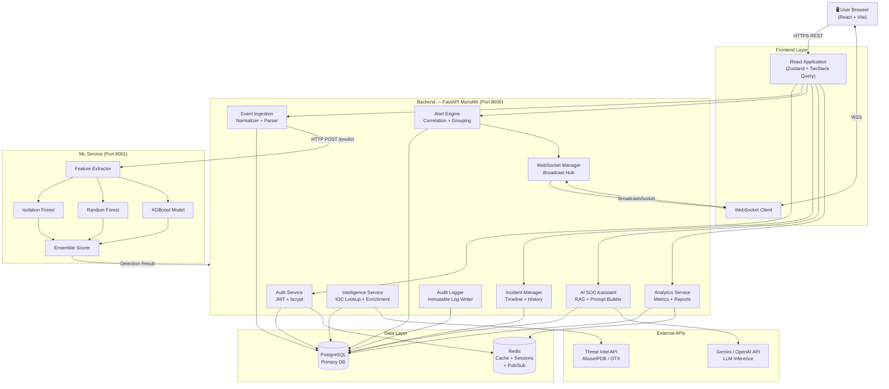
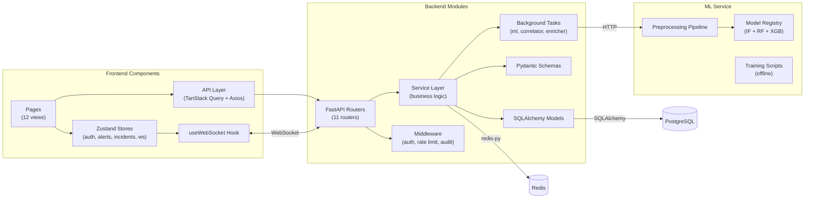
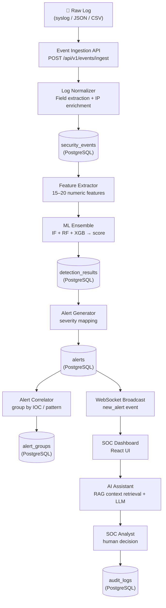
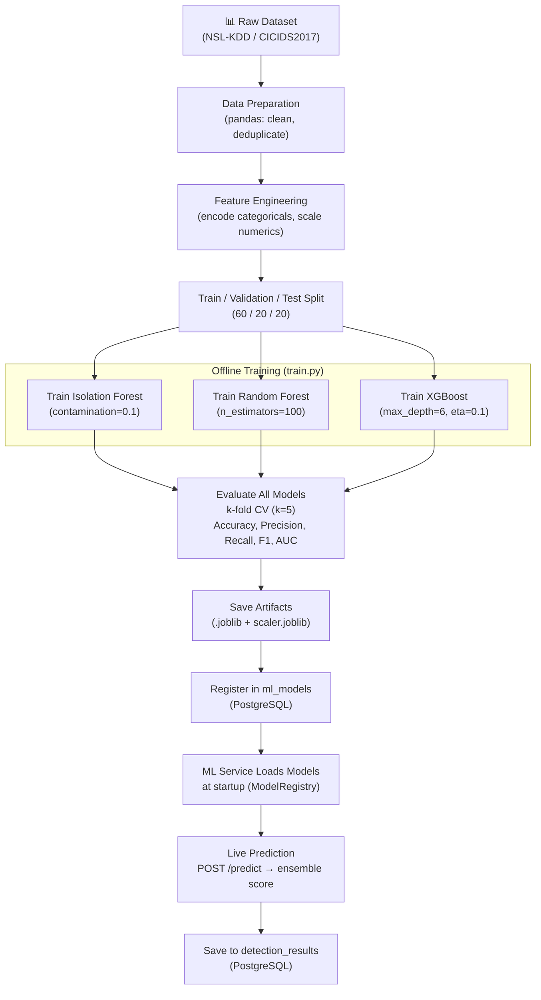
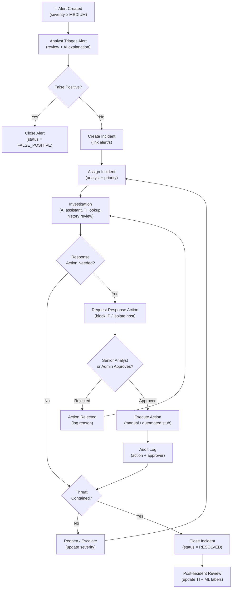

# SENTINEL: Software Architecture Document (SAD)

> **Document Version:** 1.0  
> **Status:** Approved Architecture Baseline  
> **Pattern:** Modular Monolith with Separately Deployable ML Microservice  
> **Target Audience:** Engineering Team, DevSecOps, System Architects

---

# PART 5: SYSTEM ARCHITECTURE

## 5.1 Architecture Overview

SENTINEL adopts a **Modular Monolith with Separately Deployable ML Service** architecture. This hybrid approach deliberately avoids a full microservices split while still maintaining clear internal boundaries and the option to scale the ML workload independently.

### Why Not Full Microservices?

For a student development team building a working MVP in a 20-week window, full microservices introduce:

| Problem | Impact |
|---|---|
| Service discovery overhead | Requires Consul, Kubernetes, or Istio — out of scope |
| Distributed tracing complexity | Each cross-service call must be traced manually |
| Independent deployment pipelines | 8+ CI/CD pipelines to maintain |
| Network latency between services | Adds 1–10 ms per hop between internal services |
| Operational complexity | Teams spend more time on infra than on features |

### Why Modular Monolith?

A modular monolith keeps everything in one deployable unit while enforcing strict internal boundaries through Python modules and FastAPI routers. Benefits:

- **Single deployment unit** — one `docker-compose up` starts everything
- **In-process communication** — function calls instead of HTTP calls between modules
- **Shared PostgreSQL transaction** — ACID guarantees across all modules without distributed saga patterns
- **Easy refactor path** — any module can be extracted into a true microservice later without changing its API contract
- **Appropriate for team size** — 4–6 students can own the whole codebase without coordination overhead

### ML Service Exception

The ML inference service runs as a **separate FastAPI process** (`ml_service/`) because:
1. ML libraries (scikit-learn, XGBoost) are CPU/memory heavy and benefit from isolated resource allocation
2. Model reloading without restarting the entire backend
3. Clear API boundary (`POST /predict`) that could later become a true microservice

```
sentinel/
├── frontend/          # React + Vite app
├── backend/           # FastAPI modular monolith
│   ├── app/
│   │   ├── routers/   # auth, events, detection, alerts, incidents, ...
│   │   ├── services/  # business logic per domain
│   │   ├── models/    # SQLAlchemy ORM models
│   │   ├── schemas/   # Pydantic request/response schemas
│   │   ├── middleware/ # auth, rate limit, audit
│   │   └── core/      # config, database, security utilities
├── ml_service/        # Separate ML FastAPI process
│   ├── models/        # Trained model artifacts (.joblib)
│   ├── pipeline/      # Feature extraction, preprocessing
│   └── api/           # /predict, /train, /evaluate endpoints
├── docker-compose.yml
└── docs/
```

---

## 5.2 Frontend Architecture

### Framework: React 18 + Vite + Tailwind CSS

```
frontend/
├── src/
│   ├── components/
│   │   ├── common/         # Button, Card, Badge, Modal, Table, Spinner
│   │   ├── layout/         # Sidebar, Navbar, PageWrapper
│   │   ├── charts/         # ThreatTrendChart, AlertSeverityPie, ModelMetricsBar
│   │   ├── alerts/         # AlertCard, AlertQueue, AlertDetailDrawer
│   │   ├── incidents/      # IncidentTimeline, IncidentWorkspace, AlertLinker
│   │   ├── events/         # EventTable, EventDetailDrawer, FilterPanel
│   │   ├── assistant/      # ChatWindow, MessageBubble, ContextPanel
│   │   └── intelligence/   # IOCLookup, EnrichmentResult, ThreatFeed
│   ├── pages/
│   │   ├── Login.jsx
│   │   ├── Dashboard.jsx
│   │   ├── Events.jsx
│   │   ├── Detection.jsx
│   │   ├── Alerts.jsx
│   │   ├── Incidents.jsx
│   │   ├── Assistant.jsx
│   │   ├── Intelligence.jsx
│   │   ├── Analytics.jsx
│   │   ├── ModelPerformance.jsx
│   │   ├── UserManagement.jsx
│   │   └── Settings.jsx
│   ├── stores/             # Zustand state stores
│   │   ├── authStore.js
│   │   ├── alertStore.js
│   │   ├── incidentStore.js
│   │   └── wsStore.js      # WebSocket connection state
│   ├── hooks/
│   │   ├── useWebSocket.js
│   │   ├── useAlerts.js
│   │   └── useAuth.js
│   ├── api/                # TanStack Query + Axios wrappers
│   │   ├── client.js       # Axios instance with JWT interceptor
│   │   ├── authApi.js
│   │   ├── alertsApi.js
│   │   └── ...
│   ├── utils/
│   │   ├── severityColors.js
│   │   ├── formatters.js
│   │   └── constants.js
│   └── App.jsx             # Router + protected routes
```

### State Management: Zustand

Zustand is chosen over Redux (too verbose) and React Context (re-render performance) for managing global state:

- **authStore** — JWT token, user profile, role
- **alertStore** — alert list, active filters, unread count
- **incidentStore** — open incidents, selected incident
- **wsStore** — WebSocket connection status, last message

### Real-Time Updates via WebSocket

```javascript
// hooks/useWebSocket.js
const useWebSocket = () => {
  const wsUrl = `ws://${API_HOST}/ws?token=${authStore.token}`;
  
  useEffect(() => {
    const ws = new WebSocket(wsUrl);
    
    ws.onmessage = (event) => {
      const { type, payload } = JSON.parse(event.data);
      switch (type) {
        case 'new_alert':      alertStore.prependAlert(payload); break;
        case 'alert_updated':  alertStore.updateAlert(payload); break;
        case 'incident_created': incidentStore.addIncident(payload); break;
        case 'system_health':  dashboardStore.updateHealth(payload); break;
      }
    };
    return () => ws.close();
  }, []);
};
```

### Routing: React Router v6

Protected routes check JWT validity and role before rendering. Admin-only pages (UserManagement, Settings) redirect non-admin users.

---

## 5.3 Backend Architecture

### FastAPI Modular Monolith

```
backend/app/
├── main.py                  # FastAPI app, router registration, startup events
├── core/
│   ├── config.py            # Pydantic Settings (env vars)
│   ├── database.py          # SQLAlchemy engine + session factory
│   ├── redis_client.py      # Redis connection pool
│   ├── security.py          # JWT creation/verification, bcrypt
│   └── dependencies.py      # FastAPI Depends() — get_db, get_current_user
├── routers/
│   ├── auth.py              # /api/v1/auth/*
│   ├── users.py             # /api/v1/users/*
│   ├── events.py            # /api/v1/events/*
│   ├── detection.py         # /api/v1/detection/*
│   ├── alerts.py            # /api/v1/alerts/*
│   ├── incidents.py         # /api/v1/incidents/*
│   ├── intelligence.py      # /api/v1/intelligence/*
│   ├── assistant.py         # /api/v1/assistant/*
│   ├── analytics.py         # /api/v1/analytics/*
│   ├── reports.py           # /api/v1/reports/*
│   └── admin.py             # /api/v1/admin/*
├── services/
│   ├── auth_service.py
│   ├── event_service.py
│   ├── detection_service.py  # Calls ML service API
│   ├── alert_service.py
│   ├── incident_service.py
│   ├── intelligence_service.py
│   ├── assistant_service.py  # Calls LLM API
│   ├── analytics_service.py
│   └── audit_service.py
├── models/                  # SQLAlchemy ORM models
├── schemas/                 # Pydantic schemas (request/response)
├── middleware/
│   ├── auth_middleware.py   # JWT verification
│   ├── rate_limiter.py      # Sliding window rate limit via Redis
│   └── audit_middleware.py  # Request/response audit logging
├── background/
│   ├── ml_processor.py      # Background task: submit event to ML service
│   ├── alert_correlator.py  # Background task: group related alerts
│   └── ioc_enricher.py      # Background task: enrich events with TI
└── ws/
    └── manager.py           # WebSocketManager: connect, broadcast, disconnect
```

### Background Tasks (FastAPI BackgroundTasks)

When an event is ingested:
1. Event is saved to PostgreSQL synchronously
2. HTTP 202 Accepted returned to client
3. Background task fires: `ml_processor.process_event(event_id)`
4. ML service responds → detection result saved → alert generated → WebSocket broadcast

```python
@router.post("/ingest", status_code=202)
async def ingest_event(
    event: EventIngestSchema,
    background_tasks: BackgroundTasks,
    db: Session = Depends(get_db)
):
    saved_event = event_service.save_event(db, event)
    background_tasks.add_task(ml_processor.process_event, saved_event.id)
    return {"status": "accepted", "event_id": str(saved_event.event_id)}
```

### WebSocket Manager

```python
class WebSocketManager:
    def __init__(self):
        self.active_connections: dict[str, list[WebSocket]] = {}  # role → [ws]
    
    async def connect(self, ws: WebSocket, user_id: str, role: str):
        await ws.accept()
        self.active_connections.setdefault(role, []).append(ws)
    
    async def broadcast_to_role(self, role: str, message: dict):
        for ws in self.active_connections.get(role, []):
            await ws.send_json(message)
    
    async def broadcast_all(self, message: dict):
        for connections in self.active_connections.values():
            for ws in connections:
                await ws.send_json(message)
```

---

## 5.4 Database Architecture

### PostgreSQL as Primary Database

PostgreSQL is the single source of truth for all persistent state:
- Security events, detection results, alerts, incidents
- User accounts, roles, audit logs
- ML model metadata, threat intelligence IOCs
- Investigation history and response actions

Schemas are organized into logical groups:

| Schema Group | Tables |
|---|---|
| IAM | users, roles |
| Event Pipeline | security_events, detection_results |
| Alert Management | alerts, alert_groups |
| Incident Management | incidents, incident_alerts, investigation_history |
| Threat Intelligence | threat_intelligence |
| ML Operations | ml_models |
| Governance | response_actions, audit_logs |

### Redis for Caching, Sessions, and Real-Time Queues

| Use Case | Redis Key Pattern | TTL |
|---|---|---|
| JWT session blacklist | `blacklist:{jti}` | Token remaining lifetime |
| Rate limit counters | `ratelimit:{user_id}:{window}` | 60 seconds |
| Cached dashboard metrics | `cache:dashboard:{user_id}` | 30 seconds |
| ML processing queue | `queue:ml_jobs` | Persistent list |
| WebSocket pub/sub | `channel:alerts`, `channel:incidents` | N/A |
| Recent alerts cache | `cache:alerts:recent` | 10 seconds |

---

## 5.5 Event Ingestion Architecture

### Log Normalization Pipeline

Raw logs from diverse sources are normalized into a common JSON schema before storage and ML processing.

```
Raw Log Source
     │
     ▼
┌─────────────────┐
│  Format Detector│  (detect: syslog RFC5424, JSON, CEF, CSV)
└────────┬────────┘
         │
     ┌───┴────────────────────┐
     │                        │
  Syslog Parser           JSON Normalizer
  (pylogparser)           (direct map)
     │                        │
     └───────────┬────────────┘
                 │
         ┌───────▼────────┐
         │ Field Extractor │  (src_ip, dst_ip, ports, proto, timestamp...)
         └───────┬────────┘
                 │
         ┌───────▼────────┐
         │  IP Enrichment  │  (GeoIP, ASN, private range detection)
         └───────┬────────┘
                 │
         ┌───────▼────────┐
         │ TI Cross-check  │  (match against threat_intelligence table)
         └───────┬────────┘
                 │
         ┌───────▼────────┐
         │  Save to DB     │  (security_events table, normalized_data JSONB)
         └───────┬────────┘
                 │
         Background task → ML Service
```

### Supported Input Formats

| Format | Parser | Example Source |
|---|---|---|
| Syslog RFC5424 | `pylogparser` | Linux auth.log, firewall |
| JSON | Direct mapping | Cloud logs, app logs |
| CSV | `pandas.read_csv` | SIEM exports, IDS logs |
| CEF | Custom regex | ArcSight, Splunk forwarders |

### V2: Kafka Integration

For V2, replace direct background tasks with Kafka:
- Producers: log agents → `raw-logs` topic
- Consumer group 1: Normalizer → `normalized-events` topic
- Consumer group 2: ML Processor → `ml-results` topic
- Consumer group 3: Alert Generator → alerts DB

---

## 5.6 AI/ML Service Architecture

### Deployment Options

**Option A (MVP Default):** Embedded in FastAPI as a module — simpler, single process

**Option B (Recommended for Scale):** Separate FastAPI service on port 8001

```
ml_service/
├── main.py                  # FastAPI app: POST /predict, POST /batch, GET /health
├── pipeline/
│   ├── feature_extractor.py # Extract 15–20 features from normalized event
│   ├── preprocessor.py      # StandardScaler, label encoding
│   └── postprocessor.py     # Score normalization, label mapping
├── models/
│   ├── isolation_forest.joblib
│   ├── random_forest.joblib
│   ├── xgboost_model.json
│   └── scaler.joblib
├── ensemble/
│   └── ensemble.py          # Weighted voting / stacking
└── training/
    ├── train.py             # Offline training script
    ├── evaluate.py          # k-fold CV, metrics generation
    └── data_prep.py         # NSL-KDD, CICIDS2017 preprocessing
```

### Model Loading Strategy

```python
class ModelRegistry:
    _models = {}
    
    @classmethod
    def load_all(cls):
        cls._models['isolation_forest'] = joblib.load('models/isolation_forest.joblib')
        cls._models['random_forest']    = joblib.load('models/random_forest.joblib')
        cls._models['xgboost']          = joblib.load('models/xgboost_model.joblib')
        cls._models['scaler']           = joblib.load('models/scaler.joblib')
    
    @classmethod
    def predict(cls, features: np.ndarray) -> dict:
        scaled = cls._models['scaler'].transform(features)
        
        if_score   = cls._models['isolation_forest'].decision_function(scaled)[0]
        rf_proba   = cls._models['random_forest'].predict_proba(scaled)[0]
        xgb_proba  = cls._models['xgboost'].predict_proba(scaled)[0]
        
        # Ensemble: weighted average
        ensemble_score = 0.3 * (-if_score) + 0.35 * rf_proba[1] + 0.35 * xgb_proba[1]
        label = 'malicious' if ensemble_score > 0.5 else 'normal'
        
        return {
            "prediction": label,
            "confidence": float(ensemble_score),
            "anomaly_score": float(-if_score),
            "model_scores": {"isolation_forest": float(-if_score), "random_forest": float(rf_proba[1]), "xgboost": float(xgb_proba[1])}
        }
```

---

## 5.7 LLM Integration Architecture

### Zero-Cost Free LLM Endpoints: NVIDIA NIM & Google Gemini API

> **Implementation Note (Free API Endpoints):**  
> While the conceptual architecture and functional capabilities remain identical, the generative AI and conversational reasoning capabilities in SENTINEL are powered via **free API endpoints from NVIDIA (build.nvidia.com / NVIDIA NIM Free Tier)** or a **Google Gemini API Key (Google AI Studio Free Tier)**. This eliminates GPU infrastructure requirements, reduces operational costs to zero, and allows the student team to switch between providers via simple environment variables (`LLM_PROVIDER=nvidia` or `LLM_PROVIDER=gemini`).

### RAG (Retrieval-Augmented Generation) Pattern

SENTINEL's AI SOC Assistant does NOT send raw LLM queries. All questions are answered with retrieved security context injected into the prompt.

```
User Question: "Is this alert a real threat?"
        │
        ▼
┌─────────────────────┐
│  Context Retriever   │
│  (assistant_service) │
│  - Fetch alert by ID │
│  - Fetch linked event│
│  - Fetch detection   │
│  - Fetch similar past│
│    incidents (top 3) │
│  - Fetch TI matches  │
└────────┬────────────┘
         │
         ▼
┌─────────────────────┐
│  Prompt Builder      │
│  (prompt_templates)  │
│  Injects: system msg │
│  + context block     │
│  + user question     │
└────────┬────────────┘
         │
         ▼
┌─────────────────────┐
│  LLM API Call        │
│  Gemini/OpenAI       │
└────────┬────────────┘
         │
         ▼
┌─────────────────────┐
│  Response Parser     │
│  - Strip markdown    │
│  - Extract recommend │
│  - Log exchange      │
└─────────────────────┘
```

### Prompt Engineering for Security Analysis

```python
SYSTEM_PROMPT = """
You are SENTINEL-AI, a cybersecurity analysis assistant embedded in a Security Operations Center (SOC).
You have access to real-time security data from the SENTINEL platform.
Your role is to: analyze security events, explain threats in plain English, suggest investigation steps, and recommend mitigation actions.
STRICT RULES:
- Never suggest executing system commands or scripts
- Never access external URLs or APIs directly
- Base all analysis ONLY on the context provided
- Always flag your confidence level (HIGH/MEDIUM/LOW)
- Always recommend human review before any response action
"""

def build_analysis_prompt(question: str, context: dict) -> str:
    return f"""
{SYSTEM_PROMPT}

--- SECURITY CONTEXT ---
Alert: {context['alert']}
Detection Result: {context['detection']}
Raw Event Data: {context['event']}
Threat Intelligence Matches: {context['ti_matches']}
Similar Past Incidents: {context['similar_incidents']}
--- END CONTEXT ---

Analyst Question: {question}

Provide:
1. Threat Assessment (what is happening and severity)
2. Evidence Summary (key IOCs and indicators from context)
3. Investigation Steps (ordered list of next actions)
4. Recommended Response Actions (flag each as SAFE/NEEDS-APPROVAL)
5. Confidence Level: HIGH/MEDIUM/LOW with reasoning
"""
```

---

## 5.8 Authentication & Authorization

### JWT Lifecycle

```
Login Request
     │
     ▼
Verify credentials (bcrypt compare)
     │
     ▼
Generate access_token (15 min expiry) + refresh_token (7 day expiry)
     │
     ▼
Store refresh_token in Redis: key=refresh:{user_id}, value=jti, TTL=7d
     │
     ▼
Return tokens to client
     │
     ▼
Client stores: access_token in memory (Zustand), refresh_token in httpOnly cookie
```

### Role-Based Access Control Middleware

```python
def require_role(*roles: str):
    def decorator(func):
        @wraps(func)
        async def wrapper(*args, current_user=Depends(get_current_user), **kwargs):
            if current_user.role not in roles:
                raise HTTPException(status_code=403, detail="Insufficient permissions")
            return await func(*args, current_user=current_user, **kwargs)
        return wrapper
    return decorator

# Usage
@router.get("/users", dependencies=[Depends(require_role("admin"))])
async def list_users(): ...
```

### Role Definitions

| Role | Access Level |
|---|---|
| `admin` | Full platform access, user management, system settings |
| `analyst` | Full SOC operations (events, alerts, incidents, assistant) |
| `viewer` | Read-only access to dashboard, events, alerts |
| `api_client` | Programmatic event ingestion only |

---

## 5.9 Complete Event Flow

The end-to-end lifecycle of a security event through SENTINEL:

**Step 1 — Security Event Origin**
> A network device, endpoint, or cloud system generates a security-relevant log entry (e.g., failed SSH login from an unusual IP).

**Step 2 — Event Ingestion**
> Log is submitted to `POST /api/v1/events/ingest` as syslog, JSON, or CSV. The ingestion endpoint validates the payload with Pydantic.

**Step 3 — Log Normalization**
> The raw log passes through the normalization pipeline. Source IP, destination IP, ports, protocol, timestamp, and event type are extracted. Data is stored in `security_events` with both `raw_log` (text) and `normalized_data` (JSONB).

**Step 4 — Feature Extraction**
> The ML service's `feature_extractor.py` converts normalized fields into a 15–20 dimensional numeric feature vector (packet size, port entropy, connection duration, failed auth ratio, etc.).

**Step 5 — AI/ML Detection**
> The feature vector is passed through three models in parallel:
> - Isolation Forest → anomaly score
> - Random Forest → malicious probability
> - XGBoost → malicious probability
> An ensemble weighted average produces a single `confidence_score` and `prediction_label`.

**Step 6 — Risk Scoring**
> The ensemble output is mapped to a risk level: CRITICAL (>0.9), HIGH (0.75–0.9), MEDIUM (0.5–0.75), LOW (<0.5). The detection result is saved in `detection_results`.

**Step 7 — Alert Generation**
> If risk ≥ MEDIUM, the `alert_service` auto-creates an alert in `alerts` with auto-generated title, description, and severity based on the event type and ML score.

**Step 8 — Alert Correlation**
> The `alert_correlator` background task checks if the new alert shares IOCs (source IP, attack pattern) with existing open alerts. If so, it groups them in `alert_groups`.

**Step 9 — SOC Dashboard**
> WebSocket manager broadcasts a `new_alert` event to all connected analysts. The React dashboard immediately renders the new alert in the queue without page refresh.

**Step 10 — AI Investigation Assistant**
> Analyst opens the alert and requests AI analysis via `POST /api/v1/assistant/explain/{alert_id}`. The assistant retrieves context, builds a prompt, calls the LLM API, and returns a structured analysis.

**Step 11 — Analyst Decision**
> The analyst reviews the AI assessment along with the raw evidence. They either: close as false positive, escalate to incident, or assign for further investigation. All actions are logged in `audit_logs` and `investigation_history`.

**Step 12 — Authorized Response**
> If the analyst decides on a response action (e.g., block IP), they submit via `POST /api/v1/incidents/{id}/response-actions`. The action is marked PENDING until a second analyst or admin approves it. Human-in-the-loop is mandatory.

**Step 13 — Audit Logging**
> Every state change — from event ingestion to response approval — is immutably logged in `audit_logs` with before/after state snapshots and the responsible user's identity.

---

## 5.10 Mermaid Architecture Diagram



---

## 5.11 Mermaid Component Diagram



---

## 5.12 Mermaid Data Flow Diagram



---

## 5.13 Mermaid ML Pipeline Diagram



---

## 5.14 Mermaid Incident Response Workflow



---