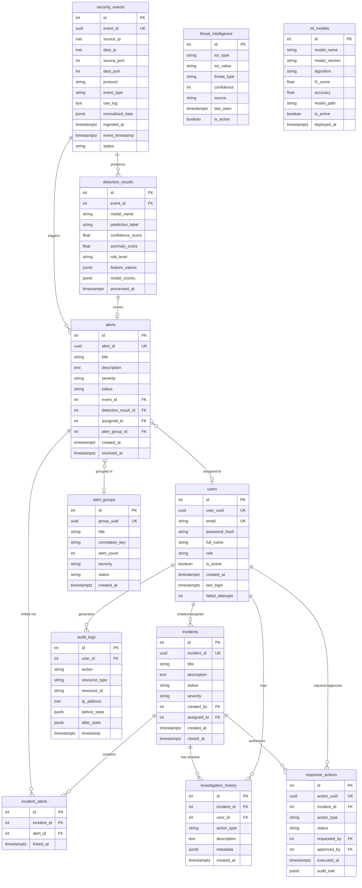

# SENTINEL: Database Design & Storage Architecture

> **Document Version:** 1.0  
> **Primary Engine:** PostgreSQL 16 (Relational + JSONB Extensibility) + Redis 7 (Cache/Queue)  
> **Entities:** 13 Normalized Tables with Full DDL, Indexes, and Integrity Constraints

---

# PART 7: DATABASE DESIGN

## 7.1 Schema Design Principles

SENTINEL's database schema follows these design principles:

1. **UUID for external identifiers** — All user-facing IDs are UUID v4 (e.g., `alert_id`, `event_id`). Internal primary keys remain integer sequences for join performance.

2. **JSONB for semi-structured data** — Fields like `normalized_data`, `feature_values`, `metadata`, and `audit_trail` use PostgreSQL JSONB rather than creating rigid column sets for every possible log field. JSONB is indexed with GIN for fast key-path queries.

3. **Immutable audit trail** — `audit_logs` has no UPDATE or DELETE grants in production. Only INSERT is permitted for the audit user role.

4. **Soft deletes** — Users are soft-deleted (`is_active = false`) rather than hard-deleted to preserve foreign key integrity in audit_logs.

5. **Timestamps in UTC** — All `TIMESTAMP` fields use `TIMESTAMP WITH TIME ZONE` defaulting to `NOW()` UTC.

6. **Strategic indexing** — Every foreign key column is indexed. High-cardinality filter columns (IP addresses, severity, status, timestamp) have dedicated B-tree indexes.

7. **Cascading deletes only where safe** — `detection_results` cascade-delete with `security_events` (derived data). `alerts` do NOT cascade-delete with `events` (alerts may outlive log retention).

---

## 7.2 Complete Entity Definitions

### Table: `users`

```sql
CREATE TABLE users (
    id              SERIAL PRIMARY KEY,
    user_uuid       UUID DEFAULT gen_random_uuid() UNIQUE NOT NULL,
    email           VARCHAR(255) UNIQUE NOT NULL,
    password_hash   VARCHAR(255) NOT NULL,
    full_name       VARCHAR(255) NOT NULL,
    role            VARCHAR(50) NOT NULL DEFAULT 'analyst'
                    CHECK (role IN ('admin', 'analyst', 'viewer', 'api_client')),
    is_active       BOOLEAN NOT NULL DEFAULT TRUE,
    created_at      TIMESTAMPTZ NOT NULL DEFAULT NOW(),
    last_login      TIMESTAMPTZ,
    failed_attempts INTEGER NOT NULL DEFAULT 0,
    locked_until    TIMESTAMPTZ
);

CREATE INDEX idx_users_email ON users(email);
CREATE INDEX idx_users_role ON users(role);
CREATE INDEX idx_users_is_active ON users(is_active);
```

### Table: `roles`

```sql
CREATE TABLE roles (
    id          SERIAL PRIMARY KEY,
    name        VARCHAR(50) UNIQUE NOT NULL,
    description TEXT,
    permissions JSONB NOT NULL DEFAULT '{}'
    -- Example: {"can_view_events": true, "can_manage_users": false, "can_approve_actions": true}
);
```

### Table: `security_events`

```sql
CREATE TABLE security_events (
    id              SERIAL PRIMARY KEY,
    event_id        UUID DEFAULT gen_random_uuid() UNIQUE NOT NULL,
    source_ip       INET,
    dest_ip         INET,
    source_port     INTEGER CHECK (source_port BETWEEN 0 AND 65535),
    dest_port       INTEGER CHECK (dest_port BETWEEN 0 AND 65535),
    protocol        VARCHAR(20),
    event_type      VARCHAR(100),
    raw_log         TEXT NOT NULL,
    normalized_data JSONB,
    ingested_at     TIMESTAMPTZ NOT NULL DEFAULT NOW(),
    event_timestamp TIMESTAMPTZ,
    status          VARCHAR(50) NOT NULL DEFAULT 'pending'
                    CHECK (status IN ('pending', 'processing', 'processed', 'failed')),
    source_format   VARCHAR(20) CHECK (source_format IN ('syslog', 'json', 'csv', 'cef'))
);

CREATE INDEX idx_events_event_id ON security_events(event_id);
CREATE INDEX idx_events_source_ip ON security_events(source_ip);
CREATE INDEX idx_events_dest_ip ON security_events(dest_ip);
CREATE INDEX idx_events_event_type ON security_events(event_type);
CREATE INDEX idx_events_status ON security_events(status);
CREATE INDEX idx_events_ingested_at ON security_events(ingested_at DESC);
CREATE INDEX idx_events_normalized_data ON security_events USING GIN(normalized_data);
```

### Table: `detection_results`

```sql
CREATE TABLE detection_results (
    id                  SERIAL PRIMARY KEY,
    event_id            INTEGER REFERENCES security_events(id) ON DELETE CASCADE,
    model_name          VARCHAR(100) NOT NULL,
    model_version       VARCHAR(50),
    prediction_label    VARCHAR(50) NOT NULL,  -- 'normal', 'malicious', 'anomaly'
    confidence_score    FLOAT NOT NULL CHECK (confidence_score BETWEEN 0.0 AND 1.0),
    anomaly_score       FLOAT,
    risk_level          VARCHAR(20) CHECK (risk_level IN ('CRITICAL','HIGH','MEDIUM','LOW','INFO')),
    feature_values      JSONB,
    model_scores        JSONB,  -- {"isolation_forest": 0.72, "random_forest": 0.88, "xgboost": 0.91}
    processed_at        TIMESTAMPTZ NOT NULL DEFAULT NOW()
);

CREATE INDEX idx_detection_event_id ON detection_results(event_id);
CREATE INDEX idx_detection_risk_level ON detection_results(risk_level);
CREATE INDEX idx_detection_prediction ON detection_results(prediction_label);
CREATE INDEX idx_detection_processed_at ON detection_results(processed_at DESC);
```

### Table: `alerts`

```sql
CREATE TABLE alerts (
    id                      SERIAL PRIMARY KEY,
    alert_id                UUID DEFAULT gen_random_uuid() UNIQUE NOT NULL,
    title                   VARCHAR(500) NOT NULL,
    description             TEXT,
    severity                VARCHAR(20) NOT NULL
                            CHECK (severity IN ('CRITICAL','HIGH','MEDIUM','LOW','INFO')),
    status                  VARCHAR(50) NOT NULL DEFAULT 'open'
                            CHECK (status IN ('open','acknowledged','in_progress','resolved','false_positive','closed')),
    event_id                INTEGER REFERENCES security_events(id),
    detection_result_id     INTEGER REFERENCES detection_results(id),
    assigned_to             INTEGER REFERENCES users(id),
    alert_group_id          INTEGER REFERENCES alert_groups(id),
    created_at              TIMESTAMPTZ NOT NULL DEFAULT NOW(),
    updated_at              TIMESTAMPTZ NOT NULL DEFAULT NOW(),
    resolved_at             TIMESTAMPTZ,
    tags                    TEXT[] DEFAULT '{}'
);

CREATE INDEX idx_alerts_alert_id ON alerts(alert_id);
CREATE INDEX idx_alerts_severity ON alerts(severity);
CREATE INDEX idx_alerts_status ON alerts(status);
CREATE INDEX idx_alerts_assigned_to ON alerts(assigned_to);
CREATE INDEX idx_alerts_created_at ON alerts(created_at DESC);
CREATE INDEX idx_alerts_event_id ON alerts(event_id);
```

### Table: `alert_groups`

```sql
CREATE TABLE alert_groups (
    id              SERIAL PRIMARY KEY,
    group_uuid      UUID DEFAULT gen_random_uuid() UNIQUE NOT NULL,
    title           VARCHAR(500) NOT NULL,
    correlation_key VARCHAR(255),   -- e.g., source IP or attack pattern hash
    alert_count     INTEGER NOT NULL DEFAULT 0,
    severity        VARCHAR(20) NOT NULL,
    status          VARCHAR(50) NOT NULL DEFAULT 'open',
    created_at      TIMESTAMPTZ NOT NULL DEFAULT NOW(),
    updated_at      TIMESTAMPTZ NOT NULL DEFAULT NOW()
);

CREATE INDEX idx_alert_groups_correlation_key ON alert_groups(correlation_key);
CREATE INDEX idx_alert_groups_status ON alert_groups(status);
```

### Table: `incidents`

```sql
CREATE TABLE incidents (
    id              SERIAL PRIMARY KEY,
    incident_id     UUID DEFAULT gen_random_uuid() UNIQUE NOT NULL,
    title           VARCHAR(500) NOT NULL,
    description     TEXT,
    status          VARCHAR(50) NOT NULL DEFAULT 'open'
                    CHECK (status IN ('open','investigating','contained','resolved','closed','reopened')),
    severity        VARCHAR(20) NOT NULL
                    CHECK (severity IN ('CRITICAL','HIGH','MEDIUM','LOW')),
    created_by      INTEGER REFERENCES users(id),
    assigned_to     INTEGER REFERENCES users(id),
    created_at      TIMESTAMPTZ NOT NULL DEFAULT NOW(),
    updated_at      TIMESTAMPTZ NOT NULL DEFAULT NOW(),
    closed_at       TIMESTAMPTZ,
    tags            TEXT[] DEFAULT '{}',
    summary         TEXT,
    mitigation_notes TEXT
);

CREATE INDEX idx_incidents_incident_id ON incidents(incident_id);
CREATE INDEX idx_incidents_status ON incidents(status);
CREATE INDEX idx_incidents_severity ON incidents(severity);
CREATE INDEX idx_incidents_assigned_to ON incidents(assigned_to);
CREATE INDEX idx_incidents_created_at ON incidents(created_at DESC);
```

### Table: `incident_alerts` (Junction)

```sql
CREATE TABLE incident_alerts (
    id          SERIAL PRIMARY KEY,
    incident_id INTEGER NOT NULL REFERENCES incidents(id) ON DELETE CASCADE,
    alert_id    INTEGER NOT NULL REFERENCES alerts(id) ON DELETE CASCADE,
    linked_at   TIMESTAMPTZ NOT NULL DEFAULT NOW(),
    linked_by   INTEGER REFERENCES users(id),
    UNIQUE(incident_id, alert_id)
);

CREATE INDEX idx_incident_alerts_incident ON incident_alerts(incident_id);
CREATE INDEX idx_incident_alerts_alert ON incident_alerts(alert_id);
```

### Table: `investigation_history`

```sql
CREATE TABLE investigation_history (
    id          SERIAL PRIMARY KEY,
    incident_id INTEGER NOT NULL REFERENCES incidents(id) ON DELETE CASCADE,
    user_id     INTEGER REFERENCES users(id),
    action_type VARCHAR(100) NOT NULL,
    -- Values: 'note_added', 'status_changed', 'alert_linked', 'ai_analysis',
    --         'action_requested', 'action_approved', 'action_executed', 'closed'
    description TEXT NOT NULL,
    metadata    JSONB,   -- e.g., {"old_status": "open", "new_status": "investigating"}
    created_at  TIMESTAMPTZ NOT NULL DEFAULT NOW()
);

CREATE INDEX idx_inv_history_incident ON investigation_history(incident_id);
CREATE INDEX idx_inv_history_user ON investigation_history(user_id);
CREATE INDEX idx_inv_history_created_at ON investigation_history(created_at DESC);
```

### Table: `threat_intelligence`

```sql
CREATE TABLE threat_intelligence (
    id          SERIAL PRIMARY KEY,
    ioc_type    VARCHAR(20) NOT NULL
                CHECK (ioc_type IN ('IP','DOMAIN','HASH','URL','EMAIL')),
    ioc_value   VARCHAR(1000) NOT NULL,
    threat_type VARCHAR(100),   -- e.g., 'C2', 'malware', 'phishing', 'scanner'
    confidence  INTEGER NOT NULL DEFAULT 50
                CHECK (confidence BETWEEN 0 AND 100),
    source      VARCHAR(100),   -- e.g., 'AbuseIPDB', 'AlienVault OTX', 'manual'
    first_seen  TIMESTAMPTZ,
    last_seen   TIMESTAMPTZ,
    is_active   BOOLEAN NOT NULL DEFAULT TRUE,
    metadata    JSONB,
    created_at  TIMESTAMPTZ NOT NULL DEFAULT NOW(),
    UNIQUE(ioc_type, ioc_value)
);

CREATE INDEX idx_ti_ioc_value ON threat_intelligence(ioc_value);
CREATE INDEX idx_ti_ioc_type ON threat_intelligence(ioc_type);
CREATE INDEX idx_ti_is_active ON threat_intelligence(is_active);
CREATE INDEX idx_ti_confidence ON threat_intelligence(confidence DESC);
```

### Table: `ml_models`

```sql
CREATE TABLE ml_models (
    id               SERIAL PRIMARY KEY,
    model_name       VARCHAR(100) NOT NULL,
    model_version    VARCHAR(50) NOT NULL,
    algorithm        VARCHAR(100) NOT NULL,  -- 'IsolationForest', 'RandomForest', 'XGBoost'
    accuracy         FLOAT,
    precision_score  FLOAT,
    recall           FLOAT,
    f1_score         FLOAT,
    auc_roc          FLOAT,
    training_dataset VARCHAR(255),           -- 'NSL-KDD', 'CICIDS2017'
    model_path       VARCHAR(500) NOT NULL,
    is_active        BOOLEAN NOT NULL DEFAULT FALSE,
    hyperparameters  JSONB,
    feature_names    TEXT[],
    trained_at       TIMESTAMPTZ,
    deployed_at      TIMESTAMPTZ,
    created_at       TIMESTAMPTZ NOT NULL DEFAULT NOW(),
    UNIQUE(model_name, model_version)
);

CREATE INDEX idx_ml_models_name ON ml_models(model_name);
CREATE INDEX idx_ml_models_is_active ON ml_models(is_active);
```

### Table: `response_actions`

```sql
CREATE TABLE response_actions (
    id               SERIAL PRIMARY KEY,
    action_uuid      UUID DEFAULT gen_random_uuid() UNIQUE NOT NULL,
    incident_id      INTEGER NOT NULL REFERENCES incidents(id),
    action_type      VARCHAR(100) NOT NULL,
    -- Values: 'block_ip', 'isolate_host', 'reset_credentials', 'notify_team', 'custom'
    action_description TEXT NOT NULL,
    status           VARCHAR(50) NOT NULL DEFAULT 'pending'
                     CHECK (status IN ('pending','approved','rejected','executing','completed','failed')),
    requested_by     INTEGER NOT NULL REFERENCES users(id),
    approved_by      INTEGER REFERENCES users(id),
    rejection_reason TEXT,
    executed_at      TIMESTAMPTZ,
    audit_trail      JSONB,
    created_at       TIMESTAMPTZ NOT NULL DEFAULT NOW(),
    updated_at       TIMESTAMPTZ NOT NULL DEFAULT NOW()
);

CREATE INDEX idx_response_incident ON response_actions(incident_id);
CREATE INDEX idx_response_status ON response_actions(status);
CREATE INDEX idx_response_requested_by ON response_actions(requested_by);
```

### Table: `audit_logs`

```sql
CREATE TABLE audit_logs (
    id            SERIAL PRIMARY KEY,
    user_id       INTEGER REFERENCES users(id),   -- NULL for system actions
    action        VARCHAR(255) NOT NULL,
    -- Values: 'login', 'logout', 'create_incident', 'update_alert', 'approve_action', etc.
    resource_type VARCHAR(100),   -- 'alert', 'incident', 'user', 'ml_model'
    resource_id   VARCHAR(100),   -- UUID or integer ID of the resource
    ip_address    INET,
    user_agent    TEXT,
    before_state  JSONB,
    after_state   JSONB,
    success       BOOLEAN NOT NULL DEFAULT TRUE,
    error_message TEXT,
    timestamp     TIMESTAMPTZ NOT NULL DEFAULT NOW()
);

CREATE INDEX idx_audit_user ON audit_logs(user_id);
CREATE INDEX idx_audit_action ON audit_logs(action);
CREATE INDEX idx_audit_resource ON audit_logs(resource_type, resource_id);
CREATE INDEX idx_audit_timestamp ON audit_logs(timestamp DESC);
-- Note: No UPDATE or DELETE granted on this table in production
```

---

## 7.3 Mermaid ER Diagram



---

## 7.4 Relationships Explanation

The core pipeline of SENTINEL flows through four tables that form the heart of the data model:

### Event → Alert → Incident → Investigation History

**Layer 1: `security_events`**
Raw or normalized logs from any source. Every observable network/system event is stored here. The event is the atomic unit of SENTINEL's data model. A single event may produce zero (if benign) or one (if anomalous) detection result.

**Layer 2: `detection_results`**
The ML service's output for a given event. Stores confidence scores from each model and the ensemble result. If the risk level is MEDIUM or above, the alert engine reads this record to generate an alert.

**Layer 3: `alerts`**
The working unit for SOC analysts. An alert is the human-readable manifestation of a detection result. Alerts have status (open → acknowledged → in_progress → resolved), severity, and assignment. Multiple related alerts may be grouped in `alert_groups` for correlated attack campaigns.

**Layer 4: `incidents`**
When an analyst determines that one or more alerts represent a real, coordinated security incident, they create an incident and link alerts to it via the `incident_alerts` junction table. An incident is the case record for the full investigation.

**Layer 5: `investigation_history`**
Every action taken on an incident — from a note added to a response action approved — is recorded as an immutable timeline entry. This is SENTINEL's investigation audit trail.

**Supporting layer: `response_actions`**
When a containment or remediation action is needed, it flows through a mandatory two-step approval (request → approve) before execution. All steps are logged.

---