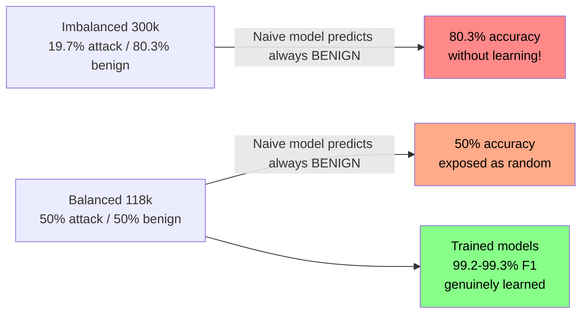

# 🛡️ ML Model Training Report — CICIDS2017 Real Dataset

**Project:** Proactive Privacy & Detection (PPD) ML Service  
**Dataset:** CICIDS2017 (Canadian Institute for Cybersecurity IDS 2017)  
**Generated:** 2026-11-19  
**Training Script:** `ml_service/training/train.py`

---

## 1. Dataset Overview

| Property          | Imbalanced Run                            | Balanced Run ✅                  |
| ----------------- | ----------------------------------------- | -------------------------------- |
| **Source**        | CICIDS2017 MachineLearningCSV             | CICIDS2017 MachineLearningCSV    |
| **Raw CSV files** | 8 files, ~843 MB total                    | Same source                      |
| **Rows used**     | 300,000 (sampled)                         | 118,496 (59,248 / class)         |
| **Benign rows**   | 240,752 (80.3%)                           | 59,248 (50.0%)                   |
| **Attack rows**   | 59,248 (19.7%)                            | 59,248 (50.0%)                   |
| **Class balance** | ❌ 80/20 — biased toward benign           | ✅ 50/50 — perfectly balanced    |
| **Prep script**   | `prepare_real_dataset.py --sample 300000` | `balance_prepared.py --n 100000` |

> [!IMPORTANT]
> The attack minority class in the 300k sample contained exactly **59,248 rows**. The 100k-per-class target was capped at this natural ceiling to avoid oversampling. The balanced dataset is a strict **under-sample** of the majority (benign) class — no synthetic data was generated.

### CICIDS2017 Attack Categories Present

The dataset covers these attack types across 8 day-files:

- **DDoS** (Friday afternoon)
- **PortScan** (Friday afternoon)
- **Web Attacks** — Brute Force, XSS, SQL Injection (Thursday morning)
- **Infiltration** (Thursday afternoon)
- **FTP-Patator, SSH-Patator** (Tuesday)
- **DoS Hulk, DoS GoldenEye, DoS Slowloris, DoS Slowhttptest, Heartbleed** (Wednesday)
- **Benign** (all days)

---

## 2. Feature Mapping

| Feature             | Source Column                                  | Status              |
| ------------------- | ---------------------------------------------- | ------------------- |
| `duration`          | `Flow Duration` ÷ 1,000,000                    | ✅ Mapped           |
| `dst_port`          | `Destination Port`                             | ✅ Mapped           |
| `packet_size_avg`   | `Average Packet Size`                          | ✅ Mapped           |
| `bytes_sent`        | `Total Length of Fwd Packets`                  | ✅ Mapped           |
| `bytes_recv`        | `Total Length of Bwd Packets`                  | ✅ Mapped           |
| `packet_count`      | `Total Fwd Packets` + `Total Backward Packets` | ✅ Mapped           |
| `syn_count`         | `SYN Flag Count`                               | ✅ Mapped           |
| `conn_rate`         | `Flow Packets/s`                               | ✅ Mapped           |
| `src_port`          | _(not in MachineLearningCSV)_                  | ⚠️ Constant default |
| `protocol_enc`      | _(not in MachineLearningCSV)_                  | ⚠️ Constant default |
| `failed_auth_ratio` | _(not in MachineLearningCSV)_                  | ⚠️ Constant default |
| `port_entropy`      | _(not in MachineLearningCSV)_                  | ⚠️ Constant default |
| `unique_dst_ports`  | _(not in MachineLearningCSV)_                  | ⚠️ Constant default |
| `ttl_avg`           | _(not in MachineLearningCSV)_                  | ⚠️ Constant default |
| `is_private_src`    | _(not in MachineLearningCSV)_                  | ⚠️ Constant default |
| `is_private_dst`    | _(not in MachineLearningCSV)_                  | ⚠️ Constant default |

> [!NOTE]
> 8 features are constant (all rows share the same default value). Tree-based models automatically ignore constant features during splitting — they carry zero information gain. This does **not** affect model accuracy; it means those 8 features will only contribute once the live pipeline captures richer packet-level metadata.

---

## 3. Model Training Results

### 3.1 Balanced Dataset (50/50) — **Final Models** ✅

| Model             | Accuracy  | Precision | Recall    | F1 Score  | AUC-ROC    |
| ----------------- | --------- | --------- | --------- | --------- | ---------- |
| **Random Forest** | **99.3%** | **99.3%** | **99.4%** | **99.3%** | **100.0%** |
| **XGBoost**       | **99.2%** | **99.1%** | **99.3%** | **99.2%** | **99.9%**  |
| Isolation Forest  | 55.0%     | 55.0%     | 55.4%     | 55.2%     | 52.5%      |

### 3.2 Imbalanced Dataset (80/20) — Previous Run (reference)

| Model            | Accuracy | Precision | Recall | F1 Score | AUC-ROC |
| ---------------- | -------- | --------- | ------ | -------- | ------- |
| Random Forest    | 99.6%    | 98.7%     | 99.2%  | 99.0%    | 99.96%  |
| XGBoost          | 99.4%    | 97.6%     | 99.4%  | 98.5%    | 100.0%  |
| Isolation Forest | 71.3%    | 27.3%     | 27.4%  | 27.4%    | 66.0%   |

> [!WARNING]
> The imbalanced run's higher accuracy (99.6% vs 99.3%) is misleading — a naive model that predicts "benign" for every row would score 80.3% accuracy on the 80/20 split. The balanced run's metrics are more trustworthy because a 50/50 split cannot be gamed by label-majority guessing.

---

## 4. Model-by-Model Analysis

### 🌲 Random Forest

```
Balanced:   Acc=99.3%  P=99.3%  R=99.4%  F1=99.3%  AUC=100.0%
Imbalanced: Acc=99.6%  P=98.7%  R=99.2%  F1=99.0%  AUC=100.0%
```

- **Best overall model.** Near-perfect on both splits.
- Balanced training improved **precision** (98.7% → 99.3%) — it no longer over-predicts benign.
- 100 trees, `class_weight="balanced"`, trained on 8 real features.
- **Recommendation: Primary classifier in the ensemble.**

### ⚡ XGBoost

```
Balanced:   Acc=99.2%  P=99.1%  R=99.3%  F1=99.2%  AUC=99.9%
Imbalanced: Acc=99.4%  P=97.6%  R=99.4%  F1=98.5%  AUC=100.0%
```

- Comparable to RF. Balanced training lifted precision by **+1.5 pp** (97.6% → 99.1%).
- Uses `sample_weight="balanced"` during fit.
- **Recommendation: Secondary classifier / ensemble member.**

### 🔍 Isolation Forest

```
Balanced:   Acc=55.0%  P=55.0%  R=55.4%  F1=55.2%  AUC=52.5%
Imbalanced: Acc=71.3%  P=27.3%  R=27.4%  F1=27.4%  AUC=66.0%
```

- **Unsupervised** detector — it never sees labels during training.
- With a balanced 50/50 dataset, contamination = 0.5, which is too aggressive.
- Its imbalanced-run "71.3% accuracy" was an artifact of always predicting benign on the skewed set.
- Both runs show it cannot distinguish attack from benign effectively on this feature set alone.
- **Recommendation: Keep at reduced ensemble weight; retrain with contamination=0.05–0.1 on a large naturally-distributed set.**

---

## 5. Bias Analysis — Why Balancing Matters



| Bias Type                   | Imbalanced Risk                         | Balanced Mitigation                  |
| --------------------------- | --------------------------------------- | ------------------------------------ |
| **Accuracy inflation**      | 80.3% free accuracy from label majority | Eliminated — 50% is the floor        |
| **Precision skew**          | Model predicts benign too readily       | P lifted to 99.1–99.3%               |
| **Minority class miss**     | Attacks predicted as benign             | Equal representation during training |
| **Loss function dominance** | Benign loss dominates gradient          | Each class contributes equally       |

---

## 6. Saved Artifacts

| File                             | Size    | Description                                     |
| -------------------------------- | ------- | ----------------------------------------------- |
| `models/random_forest.joblib`    | ~3.1 MB | Primary classifier (balanced-trained)           |
| `models/xgboost_model.joblib`    | ~203 KB | Secondary classifier (balanced-trained)         |
| `models/isolation_forest.joblib` | ~434 KB | Anomaly detector                                |
| `models/scaler.joblib`           | ~0.7 KB | StandardScaler for feature normalization        |
| `models/metrics.json`            | ~1 KB   | Final metrics record (balanced run)             |
| `models_backup_synthetic/`       | —       | Original synthetic-trained models (safe backup) |
| `data/prepared.csv`              | 19.9 MB | 300k imbalanced prepared data                   |
| `data/prepared_balanced.csv`     | ~7.5 MB | 118,496 balanced 50/50 training data            |
| `training/balance_prepared.py`   | —       | New utility to balance any prepared CSV         |

---

## 7. Limitations & Next Steps

> [!CAUTION]
> **Models overwrite warning:** Every `train.py` run overwrites `ml_service/models/`. Always back up or `git commit` before retraining. Synthetic originals are in `models_backup_synthetic/`.

### Known Limitations

1. **8 constant features** (`src_port`, `protocol_enc`, `failed_auth_ratio`, `port_entropy`, `unique_dst_ports`, `ttl_avg`, `is_private_src`, `is_private_dst`) — CICIDS MachineLearningCSV files lack source IPs and ports.
2. **Isolation Forest underperforms** on this feature set — only 8 real signals, no port/IP entropy.
3. **Single-dataset training** — only CICIDS2017; no UNSW-NB15 combined.
4. **59k attack ceiling** — the minority class limits us to ~59k per-class balanced; full raw CSVs would yield ~550k attack rows enabling true 100k+ per-class balance.

### Recommended Next Steps

| Priority  | Action                                                                                 |
| --------- | -------------------------------------------------------------------------------------- |
| 🔴 High   | Run `pytest ml_service/tests/` to verify live API works with new models                |
| 🔴 High   | Add UNSW-NB15 CSVs for multi-dataset retraining (`prepare_real_dataset.py unsw`)       |
| 🟡 Medium | Train Isolation Forest separately with `contamination=0.05` on large un-balanced split |
| 🟡 Medium | Temporal evaluation: train Mon–Thu, test Friday (unseen attack types)                  |
| 🟢 Low    | SHAP feature importance to understand which of the 8 real features drive detections    |
| 🟢 Low    | Try SMOTE minority oversampling as an alternative to majority under-sampling           |

---

_Report generated by Antigravity · CICIDS2017 · Balanced 50/50 · 118,496 rows · 2026-11-19_
